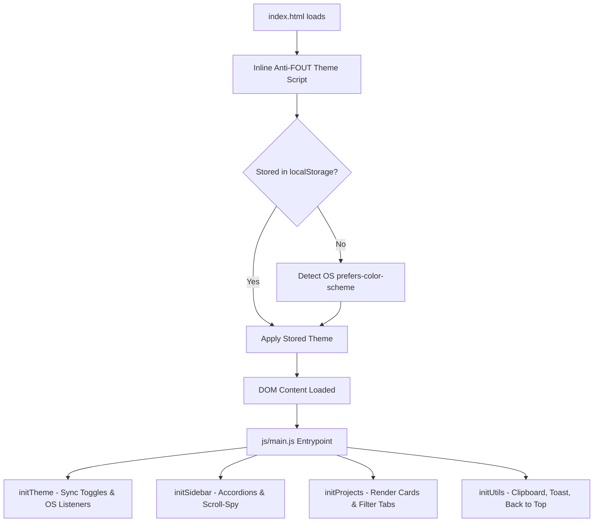

# ⚡ EduCode Portfolio — John Eduard Madriaga

[](https://educode597.github.io/)
[](https://developer.mozilla.org/en-US/docs/Web/HTML)
[](https://developer.mozilla.org/en-US/docs/Web/CSS)
[](https://developer.mozilla.org/en-US/docs/Web/JavaScript)
[](LICENSE)

> **Live Production Website:** [educode597.github.io](https://educode597.github.io/)  
> **Repository:** [github.com/EduCode597/EduCode597.github.io](https://github.com/EduCode597/EduCode597.github.io)

---

## 📖 Table of Contents

- [Overview](#-overview)
- [Key Features & User Experience](#-key-features--user-experience)
- [System Architecture](#-system-architecture)
- [Directory & File Structure](#-directory--file-structure)
- [Design System & Aesthetics](#-design-system--aesthetics)
- [JavaScript Application Modules](#-javascript-application-modules)
- [CSS Architecture & Modularity](#-css-architecture--modularity)
- [Project Showcase Catalog](#-project-showcase-catalog)
- [Getting Started & Local Development](#-getting-started--local-development)
- [Extending & Customizing the Portfolio](#-extending--customizing-the-portfolio)
- [Deployment Guide](#-deployment-guide)
- [Browser Compatibility & Performance](#-browser-compatibility--performance)
- [Author & Contact Information](#-author--contact-information)

---

## 🌟 Overview

**EduCode Portfolio** is the personal software engineering portfolio of **John Eduard Madriaga**, an Information Technology undergraduate at the **Polytechnic University of the Philippines (PUP) Sto. Tomas Campus**. 

The application is engineered as a **high-performance, zero-framework, dependency-light web application** that pairs a modern **Bento Grid layout** with a **dual-mode Floating Navigation Sidebar** and an **adaptive Theme Engine**. It highlights applied competencies in frontend engineering, scalable API designs, object-oriented software, and collaborative academic systems without the build-step overhead of heavyweight frontend frameworks.

### Core Objectives
1. **Showcase Real-World Engineering**: Highlight production web applications, academic full-stack systems, AI-integrated civic tools, and game physics engines with direct source code and live demo links.
2. **Interactive Competencies**: Enable potential employers, collaborators, and peers to cross-filter projects dynamically by tech stack or category.
3. **Flawless Design & UX**: Present a clean, distraction-free aesthetic with instant light/dark mode switching, anti-FOUT theme hydration, and responsive layout scaling across mobile, tablet, and desktop viewports.

---

## 🚀 Key Features & User Experience

| Feature | Description | Implementation Details |
| :--- | :--- | :--- |
| **Bento Grid Layout** | Modern card-based visual hierarchy displaying profile bio, technical skills, projects, and education in structured cells. | CSS Grid + Flexbox with responsive column wrapping in `css/hero.css` and `css/projects.css`. |
| **Adaptive Theme Controller** | Seamless toggle between **Stealth Minimalist Dark** (with sage green accents) and **High-Contrast Warm Light** mode. | `data-theme` attribute on `<html>`, stored in `localStorage` under `educode_portfolio_theme`, with `prefers-color-scheme` fallback. |
| **Anti-FOUT Script** | Prevents "Flash of Unstyled Theme" by reading theme settings before the DOM finishes parsing. | Synchronous inline `<script>` in the document `<head>` prior to stylesheet rendering. |
| **Floating Accordion Sidebar** | Fixed desktop sidebar (`320px`) with collapsible numbered navigation groups, live status indicator, and scroll-spy tracking. | Pure Vanilla JS with `aria-expanded` attributes and active section detection (`js/modules/sidebar.js`). |
| **Responsive Mobile Drawer** | Collapses into an off-canvas slide-out drawer on viewports `< 1200px` with floating trigger and backdrop overlay. | Body scroll-locking (`sidebar-drawer-locked`), backdrop blur, and escape key listener (`Esc`). |
| **Dynamic Project Showcase** | Centralized data source automatically generates project cards, tags, links, and status badges. | Model-View separation in `js/data/projects-data.js` and `js/modules/projects.js`. |
| **Interactive Skill Filtering** | Clicking any skill chip (e.g., React, Python, MySQL) dynamically highlights matching projects and clears on demand. | Reactive data attributes (`data-skills`, `data-category`) with active filter counters. |
| **Native Clipboard Utility** | One-click button to copy contact email address to clipboard with accessible feedback toast. | Modern `navigator.clipboard` API with an asynchronous `execCommand('copy')` fallback for non-secure contexts. |
| **Accessibility (a11y)** | Keyboard navigable drawer, WCAG-compliant color contrasts, accessible landmarks, and a skip-to-content link. | `<a class="skip-link">`, explicit ARIA roles (`tab`, `tablist`), and keyboard event handlers. |

---

## 🏛 System Architecture

The project adheres to a clean **Vanilla Web Architecture** where concerns are segregated into structural HTML, tokenized modular CSS, and single-responsibility ES6 modules.

### High-Level Initialization Flow



### Interactive Data & Event Pipeline

```mermaid
graph LR
    subgraph Data Layer
        PD[(projects-data.js)]
    end

    subgraph Controller Layer
        PM[modules/projects.js]
        SM[modules/sidebar.js]
        TM[modules/theme.js]
    end

    subgraph View / DOM
        DOMGrid[#projectsGrid]
        DOMTabs[.filter-btn tabs]
        DOMChips[.skill-chip badges]
        DOMTheme[.theme-toggle-btn]
        DOMSide[#floatingSidebar]
    end

    PD -->|Import projectsData| PM
    PM -->|Render markup| DOMGrid
    DOMTabs -->|Click filter| PM
    DOMChips -->|Click skill| PM
    PM -->|Filter & highlight cards| DOMGrid
    DOMTheme -->|Toggle event| TM
    TM -->|Set data-theme| ViewRoot[HTML Root Element]
    DOMSide -->|User interaction & Scroll| SM
```



---

## 📂 Directory & File Structure

```text
EduCode597.github.io/
├── index.html                  # Core application HTML document & semantic layout
├── style.css                   # Aggregator stylesheet importing all CSS modules
├── README.md                   # Comprehensive project documentation
├── .gitignore                  # Git ignore patterns (.agents, .claude, etc.)
│
├── css/                        # Modular stylesheet system
│   ├── tokens.css              # Color tokens, typography, shadows, radii, base reset
│   ├── sidebar.css             # Floating navigation sidebar, drawer, accordion styles
│   ├── hero.css                # Bento grid container & profile identity cards
│   ├── skills.css              # Technical competency categories & interactive chips
│   ├── projects.css            # Project showcase cards, spotlight layout, filter tabs
│   ├── education.css           # Academic journey & student community affiliation cards
│   └── footer.css              # Footer layout, toast notification, utility classes
│
├── js/                         # Modular client-side JavaScript (ES6 Modules)
│   ├── main.js                 # Application entry point orchestrating all modules
│   ├── data/
│   │   └── projects-data.js    # Centralized data model array of all projects
│   └── modules/
│       ├── theme.js            # Theme switching, OS preferences & storage sync
│       ├── sidebar.js          # Sidebar drawer, accordion states & scroll-spy
│       ├── projects.js         # Card markup generation, category & skill filtering
│       └── utils.js            # Email copy-to-clipboard, toast, back-to-top, year
│
├── fonts/                      # Self-hosted custom brand typography
│   ├── Gilroy-Bold.ttf         # Headings, project titles, display typography
│   ├── Gilroy-Medium.ttf       # Navigation items, buttons, subheadings
│   └── Gilroy-Regular.ttf      # Body copy, descriptions, metadata
│
└── images/                     # Graphic assets and showcase imagery
    ├── 49aa0712-*.jpg          # Profile avatar photograph
    ├── Madriaga_logo.svg       # Brand monogram SVG vector icon
    ├── icons/
    │   ├── PUP logo.png        # Polytechnic University of the Philippines seal
    │   └── triwan.jpg          # Triwan Club community emblem
    └── projects/
        ├── gallery.jpg         # Personal Media Gallery thumbnail preview
        ├── samsung.jpg         # Samsung S24 Ultra Showcase thumbnail preview
        └── vigan.jpg           # Vigan Heritage Escape thumbnail preview
```

---

## 🎨 Design System & Aesthetics

The portfolio leverages a bespoke design system built on **CSS Custom Properties** (CSS variables). The system defines two fully harmonized palettes:

### 1. Color Palettes

#### Dark Mode (`[data-theme="dark"]`, Default)
* **Background Primary**: `#111312` (Deep charcoal matte)
* **Surface Container**: `#171A18` (Subtle elevated dark surface)
* **Elevated Surface**: `#1F2320`
* **Soft Card Surface**: `#252B27`
* **Primary Accent**: `#788978` (Muted organic sage)
* **Accent Highlight**: `#9BB09B` (Light sage glow)
* **Text Display / Title**: `#F0ECE1` (Crisp off-white)
* **Text Primary**: `#E2DFD8`
* **Text Muted**: `#6C746C`

#### Light Mode (`[data-theme="light"]`)
* **Background Primary**: `#FEFCED` (Warm minimalist cream)
* **Surface Container**: `#FFFFFF` (Clean white card background)
* **Elevated Surface**: `#F8F7EE`
* **Soft Surface**: `#EFEBD7`
* **Primary Accent**: `#535E4B` (Deep forest olive)
* **Accent Highlight**: `#A9AE5D` (Warm moss accent)
* **Text Display / Title**: `#31352E` (Deep charcoal typography)
* **Text Secondary**: `#535E4B`
* **Text Muted**: `#737B6D`

### 2. Typography Hierarchy

Custom **Gilroy** typefaces are bundled directly in `fonts/` to ensure immediate rendering without third-party font network latency or layout shifts:

| Token / Family | Weights / Files | Primary Usage |
| :--- | :--- | :--- |
| `--font-bold` | Gilroy-Bold (700) | `h1`, `h2`, `h3`, hero title, brand wordmark |
| `--font-medium` | Gilroy-Medium (500) | Section labels, buttons, navigation links, filters |
| `--font-regular` | Gilroy-Regular (400) | Body paragraphs, bio quotes, problem descriptions |
| `--font-mono` | SF Mono, JetBrains Mono, Consolas | Code tags, version badges, numeric indices (`01`, `02`) |

---

## 💻 JavaScript Application Modules

All application logic is divided into specialized ES6 modules imported by `js/main.js`:

### 1. `js/main.js` (Orchestrator)
Bootstraps the entire application upon `DOMContentLoaded`:
```javascript
import { initSidebar } from "./modules/sidebar.js";
import { initProjects } from "./modules/projects.js";
import { initUtils } from "./modules/utils.js";
import { initTheme } from "./modules/theme.js";

document.addEventListener("DOMContentLoaded", () => {
  initTheme();
  initSidebar();
  initProjects();
  initUtils();
});
```

### 2. `js/modules/theme.js` (Theme Controller)
- **`getCurrentTheme()`**: Checks `localStorage` for `educode_portfolio_theme`. Falls back to the operating system's `(prefers-color-scheme: light)` media query.
- **`applyTheme(theme, persist)`**: Updates `<html data-theme="...">`, updates ARIA accessibility attributes (`aria-pressed`, `aria-label`) on all theme toggles, and optionally persists choice to `localStorage`.
- **`toggleTheme()`**: Inverts current theme state.
- **System Listener**: Subscribes to OS color scheme changes if the user has not established a manual preference override.

### 3. `js/modules/sidebar.js` (Navigation & Scroll-Spy)
- **Off-Canvas Drawer**: Handles mobile hamburger opening/closing with smooth CSS transitions, body scroll-locking (`sidebar-drawer-locked`), and outside-click backdrop handling.
- **Keyboard Dismissal**: Closes the drawer immediately upon pressing `Escape`.
- **Accordion Groups**: Toggles multi-level section links (`is-open` class) with dynamic ARIA expanded states.
- **Optimized Scroll-Spy**: Tracks user scroll offsets against section positions (`#about`, `#skills`, `#projects`, `#education`, `#contact`), highlighting the active link and auto-expanding the corresponding category accordion.

### 4. `js/modules/projects.js` (Project Showcase Engine)
- **`createProjectCardMarkup(project)`**: Generates accessible semantic HTML for both **Standard Cards** (featuring a problem-solved callout) and **Spotlight Cards** (featuring image thumbnails).
- **Tab Filtering**: Filters cards dynamically across `all`, `frontend`, `fullstack`, and `academic` categories.
- **Skill Highlight Mechanism**: Listens for clicks on skill chips (e.g. `react`, `python`, `mysql`). Automatically reveals matching projects, highlights their badges, and displays an active filter reset button.
- **Count Synchronization**: Real-time recalculation of numeric counters displayed on filter tabs.

### 5. `js/modules/utils.js` (Helper Utilities)
- **Email Clipboard Copy**: Reads email from `data-email` attribute, leverages `navigator.clipboard.writeText()` with a `document.execCommand('copy')` fallback for non-SSL or local file environments, and animates a toast notification for 2.8 seconds.
- **Back to Top**: Smooth scrolling to coordinate `(0, 0)`.
- **Dynamic Copyright**: Injects current calendar year into `#currentYear`.

---

## 🎨 CSS Architecture & Modularity

The styles are partitioned into focused, single-responsibility stylesheets imported via `style.css`:

```
style.css
 ├── css/tokens.css       -> Colors, variables, resets, container, Gilroy @font-face
 ├── css/sidebar.css      -> Floating sidebar, mobile drawer, accordions, scroll-spy
 ├── css/hero.css         -> Bento hero section, avatar card, bio card, contact card
 ├── css/skills.css       -> Skills matrices, chip tags, interactive selection styles
 ├── css/projects.css     -> Project grid layout, problem-box, tech-tags, filter tabs
 ├── css/education.css    -> PUP and Triwan Club credential cards
 └── css/footer.css       -> Site footer, back-to-top button, feedback copy-toast
```

### Responsive Breakpoints
* **Desktop Wide (`>= 1200px`)**:
  - Main container reserves `margin-left: 320px` for the permanently visible floating glass sidebar.
  - Mobile hamburger toggle and mobile theme toggle remain hidden.
* **Tablet / Small Laptop (`992px - 1199px`)**:
  - Main content takes full screen width.
  - Sidebar collapses into an off-canvas drawer opened via the fixed floating `#sidebarToggleBtn`.
* **Mobile Devices (`< 768px`)**:
  - Bento cards collapse from multi-column grids into a clean single-column vertical flow.
  - Interactive skill chips and action buttons scale to comfortable minimum 44px touch targets.

---

## 🗂 Project Showcase Catalog

The portfolio dynamically renders **10 software engineering repositories and case studies** configured in `js/data/projects-data.js`:

| # | Project Name | Category | Primary Stack | Live Demo / Repo |
| :---: | :--- | :--- | :--- | :--- |
| **01** | **CitiSent — Emotion-Aware Civic Reporting** | Full-Stack • AI Service | React 19, Tailwind v4, FastAPI, Gemini AI, Supabase, WebSockets | [GitHub Repo](https://github.com/CitiSent-Project/CitiSent) |
| **02** | **PinoyVideoke / Karaoke** | Web Application | React, TypeScript, Web Audio API, CSS Modules | [Live Demo](https://karaoke-navy-ten.vercel.app) • [Source Code](https://github.com/EduCode597/Karaoke) |
| **03** | **SnapEat — Food & Calorie Tracking** | Nutrition & Web App | Python, JavaScript, HTML5/CSS3, REST API | [Live Demo](https://snapeat-henna.vercel.app) • [Source Code](https://github.com/timbibat/snapeat) |
| **04** | **Hotel Management System** | Enterprise Backend | PHP, MySQL, Relational Modeling, JavaScript | [GitHub Repo](https://github.com/DarrenGuev/Hotel-Management-System) |
| **05** | **VENTO-corp Enterprise Portal** | INTE302 Final Project | PHP, OOP Architecture, MySQL, HTML5/CSS3 | [GitHub Repo](https://github.com/sijey-CJAA/VENTO-corp) |
| **06** | **GameDevCars — 2D Physics Simulator** | Game Engineering | Python, Pygame, OOP Vectors, Collision Algorithms | [GitHub Repo](https://github.com/DarrenGuev/GameDevCars) |
| **07** | **OOP — Dream Team Core Concepts** | OOP Paradigms | Python, OOP Inheritance & Polymorphism, JavaScript | [GitHub Repo](https://github.com/EduCode597/OOP) |
| **08** | **Samsung S24 Ultra Showcase** | Product Landing | HTML5, CSS3, Bootstrap 5, Responsive Design | [Live Demo](https://educode597.github.io/SamsungS24Ultra/) • [Source Code](https://github.com/EduCode597/SamsungS24Ultra) |
| **09** | **Vigan Heritage Escape** | Cultural & Tourism Web | HTML5, CSS3, Bootstrap 5, Content Architecture | [Live Demo](https://educode597.github.io/Vigan-City/) • [Source Code](https://github.com/EduCode597/Vigan-City) |
| **10** | **Personal Media Gallery** | Media Grid | HTML5, CSS Grid, Media Queries | [Live Demo](https://educode597.github.io/Gallery/) • [Source Code](https://github.com/EduCode597/Gallery) |

---

## 🛠 Getting Started & Local Development

Because this project is built using native ES6 JavaScript modules and vanilla CSS, **no build tooling (npm, webpack, vite) is strictly required**. However, due to browser CORS policies regarding local file imports (`file://`), files must be served over an HTTP local server.

### Prerequisites
- Modern web browser (Chrome, Firefox, Safari, Edge)
- Any static HTTP server (e.g., Python 3, Node `serve`, or VS Code Live Server)

### Quick Start Options

#### Option A: Using Python 3 (Installed by default on many systems)
```bash
# Clone the repository
git clone https://github.com/EduCode597/EduCode597.github.io.git

# Navigate into the project directory
cd EduCode597.github.io

# Start a local HTTP server on port 8000
python -m http.server 8000

# Open in your browser
# Navigate to http://localhost:8000
```

#### Option B: Using Node.js `npx serve`
```bash
# Run directly without global installation
npx serve .
```

#### Option C: Using VS Code Live Server Extension
1. Open the repository folder in **VS Code**.
2. Right-click `index.html` in the file explorer.
3. Select **"Open with Live Server"**.

---

## 🔧 Extending & Customizing the Portfolio

### 1. Adding a New Project
Open `js/data/projects-data.js` and add a new object to the `projectsData` array:

```javascript
{
  id: "my-new-project",
  title: "Project Title",
  category: "fullstack", // Options: "frontend" | "fullstack" | "academic"
  categoryLabel: "Web App • API",
  status: "Live Deployed",
  layout: "project-regular", // Or "project-spotlight" (requires 'thumb' image path)
  skills: "react nodejs mysql", // Space-separated skill keys matching data-skill attributes
  problemSolved: "Clear summary of the engineering challenge resolved by this application.",
  techTags: ["React", "Node.js", "Express", "MySQL"],
  links: [
    {
      label: "Live Demo",
      url: "https://your-demo.url",
      icon: "bi-box-arrow-up-right",
      isPrimary: true
    },
    {
      label: "Source Code",
      url: "https://github.com/EduCode597/your-repo",
      icon: "bi-github",
      isPrimary: false
    }
  ]
}
```

### 2. Modifying or Adding Technical Skills
1. Open `index.html` and locate the `<section id="skills">`.
2. Add a `<button>` inside the appropriate category:
   ```html
   <button type="button" class="skill-chip" data-skill="graphql">
     <i class="bi bi-diagram-2"></i><span>GraphQL</span>
   </button>
   ```
3. Include the skill identifier (e.g. `graphql`) in the `skills` string of relevant items in `js/data/projects-data.js`.

### 3. Adjusting Color Tokens & Themes
Open `css/tokens.css`:
- Modify `:root { ... }` for the default **Dark Mode** values.
- Modify `[data-theme="light"] { ... }` for the **Light Mode** palette.

---

## 🚀 Deployment Guide

This project is optimized for instant hosting on **GitHub Pages**, **Vercel**, or **Netlify**:

### Deploying to GitHub Pages
1. Push your repository commits to GitHub on the `main` branch:
   ```bash
   git add .
   git commit -m "feat: update portfolio content"
   git push origin main
   ```
2. Navigate to your repository on GitHub:
   - Go to **Settings** > **Pages**.
   - Under **Build and deployment**:
     - **Source**: `Deploy from a branch`
     - **Branch**: `main` / `root`
   - Click **Save**.
3. Your site will be live at `https://<username>.github.io/<repo>/` (or `https://<username>.github.io` for user pages).

---

## 🌐 Browser Compatibility & Performance

- **Chrome / Edge**: Fully supported (v80+)
- **Mozilla Firefox**: Fully supported (v75+)
- **Apple Safari**: Fully supported (iOS 13+ / macOS Safari 13.1+)
- **Zero Build Artifacts**: Instantaneous load times with zero JavaScript bundle overhead, tree-shaking lag, or transpilation artifacts.
- **Font Display Optimization**: `font-display: swap` ensures no render-blocking text delays.
- **Image Optimization**: Project thumbnails and icons are delivered in compressed formats with explicit `width`, `height`, and `loading="lazy"` attributes to prevent cumulative layout shifts (CLS).

---

## 👤 Author & Contact Information

**John Eduard Madriaga (EduCode)**  
*Aspiring Full-Stack Web Developer & BSIT Student*  
*Polytechnic University of the Philippines — Sto. Tomas Campus*

- 🌐 **Portfolio Website**: [educode597.github.io](https://educode597.github.io/)
- 💻 **GitHub Profile**: [@EduCode597](https://github.com/EduCode597)
- 💼 **LinkedIn Profile**: [John Eduard Madriaga](https://linkedin.com/in/john-eduard-madriaga-8b656434b)
- 📧 **Direct Inquiries**: `educode597@gmail.com`
- 📱 **Social**: [Facebook](https://www.facebook.com/johneduard.madriaga.7) • [Instagram](https://www.instagram.com/duard.gg/)

---

## 📄 License

This project is open source and available under the terms of the [MIT License](LICENSE).
